# Server Event Manager

Project Zomboid Build 42 mod for multiplayer servers. It gives server admins an in-game console to set up,
force, schedule and cancel server events: airdrops, hostile camps, migrating hordes, wildfires, super zombies, convoy
wrecks, sieges, manhunts, rescue calls and aircraft crashes. Players get on-screen alerts, a sound and map markers. Mod id
`ServerEventManager`, author JoshuaSHenderson, version 0.3.0-beta.

> **Beta, under active development. Expect bugs.** If you hit one, please
> [open an issue](https://github.com/JoshuaSHenderson/ProjectZomboid-Server-Event-Manager/issues) with what you did and your `console.txt`.

Steam Workshop: https://steamcommunity.com/sharedfiles/filedetails/?id=3830652321

## Screenshots

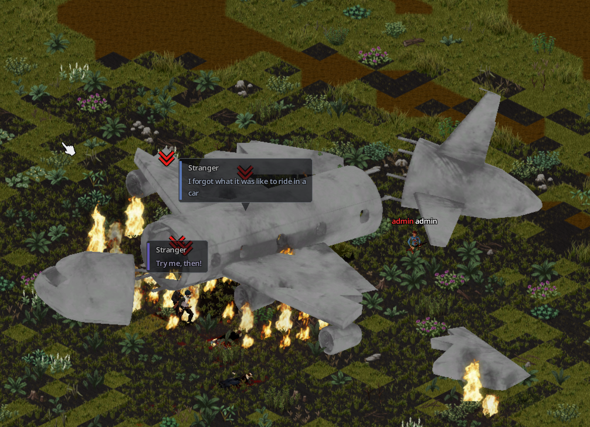

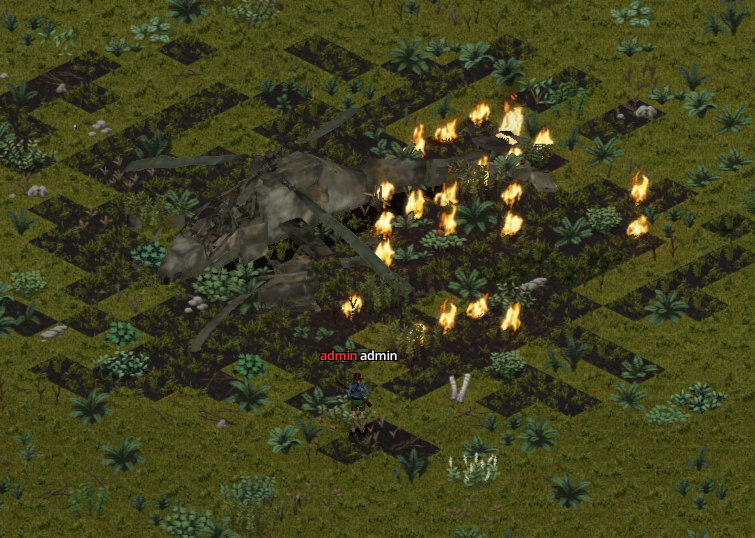

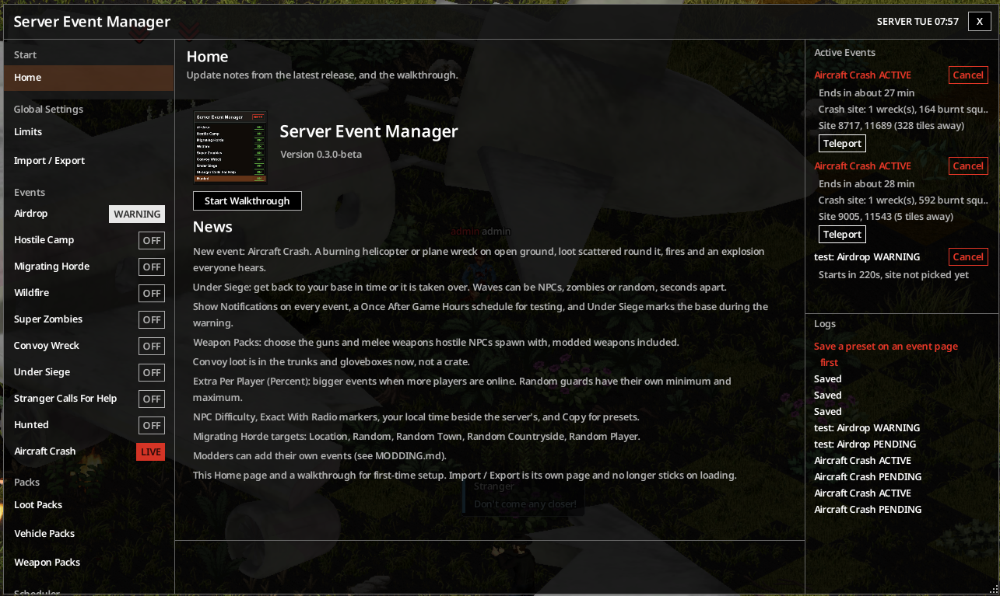

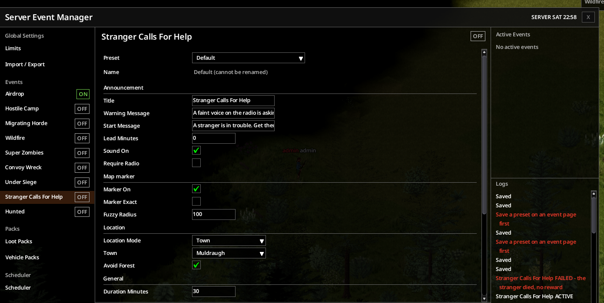

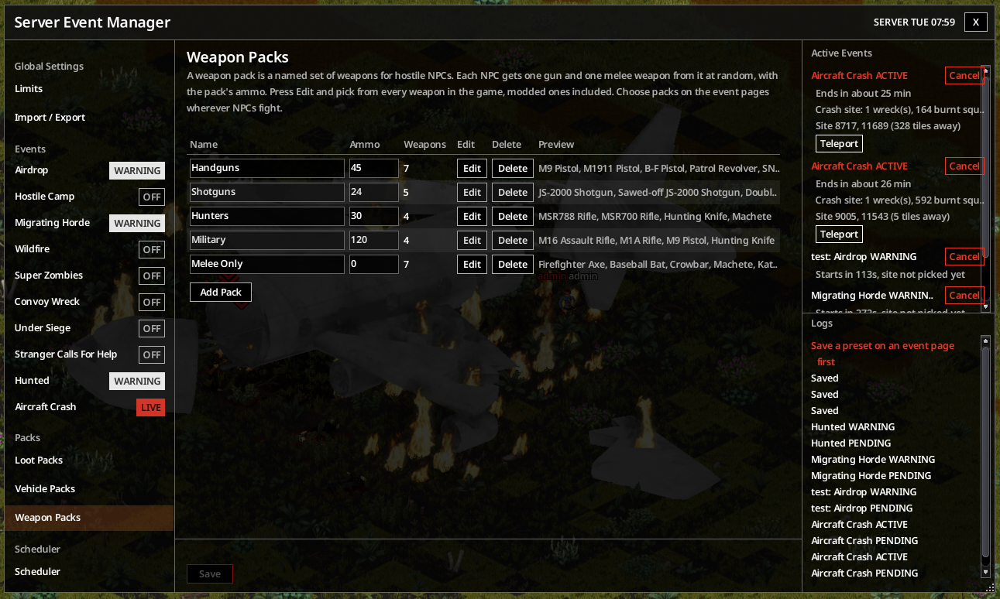

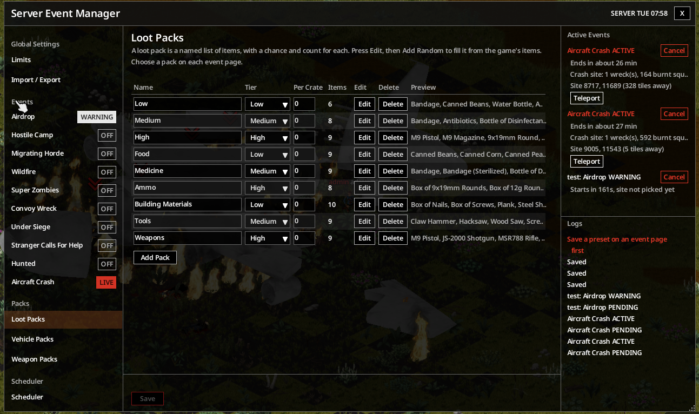

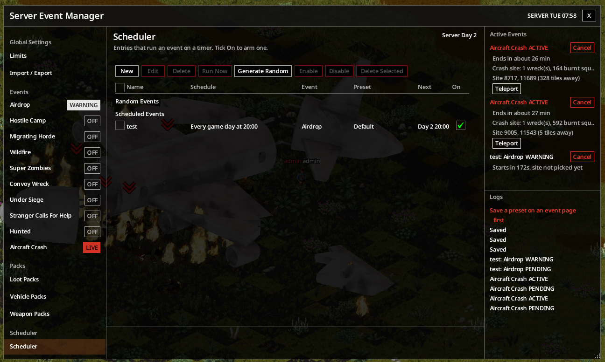

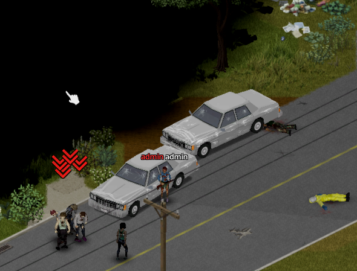

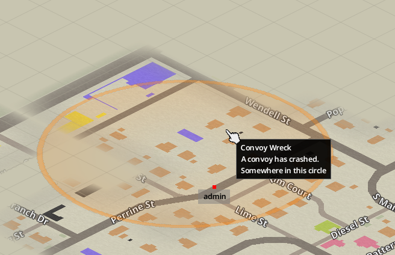

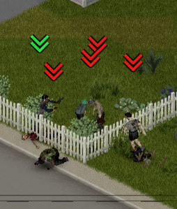

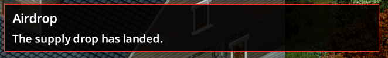

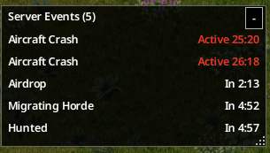

## Status

Beta. Unit specs and a self-test inside real Project Zomboid Lua pass, and the console and most events have been played on a test
server. It has had a first run on a live server; 0.2.0-beta and 0.3.0-beta come from its lists and from rig tests. 0.3.0-beta was
played on the test server with A-Life and Jeem; see [Known limits](#known-limits) for what it has not proven. Large servers and
other mod lists are still lightly tested.

## Requirements

- Project Zomboid Build 42, version 42.21 or newer (`versionMin=42.21.0`).
- A multiplayer server. In singleplayer the console is hidden and server commands do not reach the mod. The mod
  is built and tested on dedicated servers; hosting from the game menu is untested.
- Admin access level. The check is exact `admin`, repeated on the server for every command. Moderators and other
  levels cannot open or use the console.

**Optional dependencies.** The mod runs on its own, but everything with NPCs needs these:

- [Project A-Life](https://steamcommunity.com/sharedfiles/filedetails/?id=3803984183): required for all NPCs: NPC guards, Hostile Camp survivors, Under Siege NPC waves, Stranger Calls For Help and Hunted. Workshop id `3803984183`, mod id `ProjectALifeNPCs`.
- [Project A-Life - Jeem Extension](https://steamcommunity.com/sharedfiles/filedetails/?id=3806944055): adds Jeem bases as targets and protected zones, and faction standing for the stranger's reward. Workshop id `3806944055`, mod id `ProjectALifeJimmy`.

Without A-Life, guards and camps use zombies, Under Siege runs zombie waves only (an NPC wave type fails, Random picks
zombies), and Stranger Calls For Help and Hunted fail.

## Install on a server

1. Add the mod to the server's `Mods=` and `WorkshopItems=` lists. Workshop id `3830652321`. Mod id:
   `ServerEventManager`.
2. If you use A-Life, list it before this mod. `mod.info` already says `loadModAfter=\ProjectALifeNPCs`.
3. Players need the mod too (the console, alerts and map markers are client code), so a Steam server's normal
   Workshop sync covers them.
4. Restart the server. The server log shows `[SEM] server loaded v1`.

Settings, presets and schedules are saved in the world's ModData (`ServerEventManager.Config` and
`ServerEventManager.World`), so they live with the save.

## Opening the console

As an admin, any of:

- **F7**. It is registered in the vanilla key list under `[SEM]` as "SEM Console", so you can rebind it in Options.
- The world context menu (right-click): **Server Event Manager**.
- The **Server Event Manager** button on the Admin Panel.

Non-admins get none of these. A non-admin who sends a command by hand is rejected and `[SEM] rejected <command>` is
logged on the server.

## Console tour

- **Left rail**, in sections: **Start** (Home), **Global Settings** (Limits, Import / Export), **Events** (the ten events),
  **Modded Events** (only when another mod has registered one), **Packs** (Loot Packs, Vehicle Packs, Weapon Packs) and **Scheduler**. Each
  event has a status pill: OFF, ON, WARNING or LIVE. ON means an enabled schedule entry runs that event. A `*` after a name
  marks unsaved edits. The rail and the console's own buttons play a click sound.
- **Home:** every open starts here. It shows the logo, the version and the update notes. The first time on a computer it asks
  whether to run the walkthrough; after that a **Start Walkthrough** button sits under the logo. The walkthrough highlights the
  real controls one step at a time and only shows: it never saves, changes config or fires an event. Cancel or closing the
  console ends it.
- **Centre, event pages:** one screen. Pick a preset (every event has a Default), edit, then **Update**, **Save As**, **Copy** (a new unsaved preset named "<name> Copy", edits included, that Save As stores), **Cancel**, **Delete** or **Trigger Now**. Every option has a `?` with a hover blurb.
  Invalid fields turn red and block saving. The server validates again on save. Confirmations are popups. Fields show only
  when they apply (for example Town only for the Town location mode).
- **Right side:** **Active Events** above **Logs**.
  - Active Events lists each live run with Cancel, a line or two of detail, and **Teleport**, which sends the
    chat command `/teleportto x,y,0` to the run's site.
  - Logs show notices, then history, newest first: fired, ended, cancelled, failed, and schedule skips with a reason.
- **Header:** the server clock (marked SERVER once the server has sent it), with your own local time beside it as YOURS.
  Real-World windows use the server clock.
- **Presets:** on each event page. **Save As** keeps the page's current options under a new name, **Update** saves
  edits to the chosen preset, and **Delete** removes it after a popup asks. At most 50 presets. A preset belongs to one event.
- **Scheduler page:** a table of entries (see [Scheduler](#scheduler)).
- **Limits page:** Max Zombies Per Event (1 to 500, default 200) and Max Concurrent Events (1 to 5, default 2).
- **Trigger Now:** on the event page. A popup confirms the event and where it will happen. It runs the **saved** options;
  with unsaved edits it asks to Save and Trigger first, and skips the schedule and the cooldown. Forced events always start and do not count toward
  Max Concurrent Events.
- **Import / Export page:** the whole config as JSON in one editable box, with **Copy**, **Paste**, **Save** and **Reload**.
  Save checks the JSON first and asks in a popup.
- **Several packs:** an event can use more than one loot or vehicle pack.
- **Resizable windows:** console windows, including the Server Events bar, can be resized.

Nothing happens on its own until you force an event or arm a Scheduler entry. All events start with default settings
and no schedules.

## Events

Every event shares these option groups:

- **Announcement:** Title (60 characters), Warning Message and Start Message (200 each), Lead Minutes (0 to 60, default 5),
  Sound On, Require Radio.
- **Map marker:** Marker On, Marker Exact, Exact With Radio, Fuzzy Radius (10 to 500 tiles, default 100). Exact pins the spot
  with a small blinking marker. Otherwise players see a circle of the fuzzy radius that contains the site off-centre. Exact With
  Radio (default off) shows players carrying a charged radio or walkie-talkie the exact spot instead of the circle; the client
  decides, so a modded client could show it to anyone.
- **Location:** Location Mode, plus the field that mode needs: Location for Map, Town for Town, Chosen Player for Near Chosen
  Player, Minimum Character Age in Days (0 to 3650, default 0) for Near Random Player. Avoid Forest shows for Town, Countryside
  and the two near-player modes. Migrating Horde, Under Siege and Hunted have no location options; they pick their own site.
- **General:** Duration Minutes (1 to 240). When it runs out the event ends and cleans up.
- **Extra Per Player (Percent)** (0 to 200, default 0) on every event with a count: each online player beyond the first adds
  this percent to the event's counts, rounded down (50 with 3 players turns 10 into 20). NPC counts still stop at 10 and zombies
  at the zombie limit. Wildfire has none; on Airdrop, Convoy Wreck and Aircraft Crash it sits with the guards.
- **NPC Difficulty** (Easy, Normal, Hard, Brutal; default Normal) wherever NPCs spawn: guards, Hostile Camp, Under Siege NPC
  waves and Hunted. It sets only health, damage dealt and damage taken, not aim. Easy: 35 health, deals 70%. Normal: A-Life's own
  values. Hard: 75 health, deals 130%, takes 15% less. Brutal: 100 health, deals 180%, takes 30% less.

### Airdrop

A crate drops at the site and a helicopter is heard once it lands.

- **Crate:** Crate Count (1 to 5, spread around the first), loot (see [Loot](#loot)), Smoke, Flyover Sound (needs Sound
  On; plays for 10 seconds once the crates are down, stops on Cancel), Remove When Empty.
- **Guards:** see [Guards](#guards).
- Ends when every crate is empty ("all loot taken") or time runs out. Empty crates are removed if Remove When Empty is
  on. Any crate is removed at the end only when no player is within 25 tiles. On Cancel the same 25-tile rule decides,
  even for an empty crate.

### Hostile Camp

- **With A-Life:** a camp of Group Size (1 to 10) hostile survivors at the chosen NPC Level. A-Life builds the tents and
  campfire scene for the first 8; any more hold the spot. If A-Life refuses the scene, the survivors hold the spot
  without it and the Logs say so.
- **Group:** Faction (a name shown in the feed only, optional), Group Size, NPC Level, Guard Leash (2 to 30, default 8).
- **Loot:** Loot Crate (default on) with the usual loot options. The crate is the prize.
- **Fallback:** if A-Life is missing or the camp cannot be made, Fallback Count (0 to 500, default 10) raider zombies
  appear around the crate, in the Fallback Outfit (default `Bandit`; an unknown name is replaced by it). Fallback Count 0
  means no camp without A-Life: the run fails.
- Ends when every survivor that joined the camp is dead ("camp cleared"), when the loot is gone, or at the time limit.
  Which survivors belong to the camp is worked out by counting A-Life NPCs that appear within 40 tiles of the camp in
  the first 120 seconds.

### Migrating Horde

Zombies spawn out of sight near a player and walk to a target.

- **Horde:** Size (1 to 500, default 30, capped by the zombie limit), Spawn Distance (30 to 150 tiles, default 60), Respect
  Protected.
- **Target:** Target Type is one of Location, Random, Random Town, Random Countryside or Random Player (default). Random
  Player starts on a random online player, then follows whichever player is nearest the group; Minimum Character Age in Days
  (shown for Random Player) skips younger characters. Random Town and Random Countryside pick a spot the way those location
  modes do. Location uses Target Location. Random tries town, countryside and player in random order until one is available;
its player pick ignores Minimum Character Age.
  Presets saved with the old base targets become Random Player. Require Player Near (default on) fails the run if no player is
  within 200 tiles of the target.
- **Pulse:** Pulse Interval (5 to 120 seconds, default 15) and Pulse Radius (10 to 100, default 40).
- It spawns in batches of 10 every half second on loaded ground at least 30 tiles from every player. It steers by
  repeating a sound 20 tiles ahead of the group (see [Known limits](#known-limits)). The marker follows the group about
  once a minute.
- Reaching the target does not end it. Ends when all are dead or at the time limit. Surviving zombies stay in the world. A
  server restart ends a running horde, and its zombies stay.

### Wildfire

- **Fire:** Seed Count (1 to 20, default 3), Seed Spacing (1 to 30), Energy (1 to 100), Burn Minutes (1 to 60, default 10),
  Max Burn Squares (1 to 300, default 60), Smoke. Protected zones always stay fire free.
- Fires start outdoors near the site and spread by themselves. Once a minute the mod scans around the fires: fire inside a
  protected zone is put out, and past Max Burn Squares the outermost fire is put out, so a blaze stays small.
- At the end, on Cancel and on failure, a sweep puts out every fire around each seed. If the area is not loaded the sweep
  waits and finishes when it loads, even after a restart. See [Known limits](#known-limits).

### Super Zombies

- **Zombies:** Count (1 to 500, default 5), Speed (Shambler, Fast, Sprinter; default Sprinter), HP Multiplier (1 to 20,
  default 3), Outfit (empty is random clothing; an unknown name falls back to random).
- **Boss:** one of the group gets Boss HP (1 to 50, default 10) and wears the `PrivateMilitia` outfit unless you set one.
- **Map marker:** Follow Marker moves the marker with the group about once a minute.
- They spawn in a ring of 10 tiles around the site. Ends when all are dead or at the time limit; survivors stay.

### Convoy Wreck

- **Vehicles:** one or more Vehicle Packs, chosen in the picker from the Vehicle Packs page, or Random pack (empty uses the defaults `Base.CarNormal`,
  `Base.PickUpTruck`, `Base.SUV`, `Base.PickUpVan`, `Base.OffRoad`), Vehicle Count (1 to 6, default 2), Damage (0 to 100
  percent, default 60). Unknown ids are skipped and listed in Logs.
- The loot (the usual loot options) is the convoy's cargo, shared out over the vehicles' trunks and gloveboxes. Only when
  the vehicles have no container does a loot crate sit beside them instead. [Guards](#guards), which Convoy Wreck always
  has. For the random location modes it first tries for a road site.
- Ends when its guards are all dead or at the time limit. The loot and the wrecks stay in the world.

### Aircraft Crash

- A burning crash site: a crashed helicopter or plane (the mod's own 3D models, `Base.SEM_CrashHeli` and
  `Base.SEM_CrashPlane`), scorched ground, loot (the usual loot options) scattered on the ground from the
  wreck's body out to just past its footprint (never inside the solid body), burnt ground round the wreck, and
  [guards](#guards) (default none). A
  loud explosion plays once for every player as it goes active (Sound On; Require Radio applies). The aircraft lands only in a
  clear field: grass or dirt with no trees, buildings, roads, water or solid objects under its whole footprint (the plane needs
  a much bigger one). It waits until the ground within 40 tiles of the site is loaded (or a player is near) before it looks.
  When that ground has none, the crash moves to a new site, and the marker with it, up to 5 times, then fails. Only Town,
  Countryside and the two near-player modes can move; Map and the safehouse and Jeem base modes fail at once. There is no
  stand-in wreck. If no loot fits around the aircraft the run fails and no fire starts. It ends when every item is picked
  up or at the time limit; what is left stays on the ground. Location Mode defaults to
  Countryside.
- **Wreck:** Aircraft (Random, Helicopter or Plane; default Random), Burnt Cars (0 to 6 extra burnt cars around the
  aircraft, default 0).
- **Fire:** Fires (0 to 8, default 3), Burn Minutes (1 to 30, default 5). Fires never start on the crate or on safehouse
  and Jeem base ground. They are contained by Wildfire's scans: fire on protected ground is put out, and at most 40 squares
  burn at once. All are put out after Burn Minutes, at the end, on Cancel and on failure.
- Ends when the loot is taken or at the time limit. The wrecks and scorched ground stay in the world.

### Under Siege

Waves attack a player's safehouse or Jeem base, one at a time. NPC waves (need A-Life) use A-Life's raid mode, so they fight
the players there and may force entry. Zombie waves need no A-Life; they spawn and are steered toward the base like a
Migrating Horde.

- **Target:** Target Base (Random, Random Safehouse, Random Jeem Base, Chosen Base), Chosen Base. Random choices only pick a
  base with a player within 100 tiles. A Chosen Base waits for a player until Duration ends. A base with nobody online is never
  picked.
- **Attackers:** Wave Type (NPC, Zombies or Random; default NPC; Random picks NPC or zombies each run, and zombies without
  A-Life), Attackers Per Wave (NPCs, 1 to 10, default 4), Zombie Attackers (1 to 500, default 40, capped by the zombie limit),
  Waves (1 to 6, default 2), Seconds Between Waves (10 to 1800, default 300, counted from when a wave is beaten), Wave Warning
  Seconds (5 to 120, default 30, between the "They are coming!" notice and the wave), NPC tier, Spawn Distance (25 to 60,
  default 40).
- **Defence:** Return Minutes (1 to 60, default 5). The clock starts with the siege and again at each wave's warning. A player
  who comes within 100 tiles of the base before it runs out has defended that wave: there is no overrun, even if they leave
  again, and the wave waits for a player near the base (the siege can still fail at Duration, without a takeover). If nobody
  came in time, the wave attacks anyway and the siege fails. Takeover (default on) then saves the base to be taken over the next time a player's arrival loads it: Loot Lost
  Percent (0 to 100, default 25) of the items in its containers is destroyed at random, Takeover Fires (0 to 20, default 3)
  small fires start inside and are put out after 3 minutes, the wave's enemies occupy it, and nearby players get "Your base has
  been overrun." This is the one thing that ignores safehouse protection.
- Ends when every wave is out and all attackers are dead, or at Duration. Attackers still alive stay in the world (NPCs under
  A-Life).

### Stranger Calls For Help

Needs A-Life. A friendly NPC calls for help. Nothing spawns until a player is within 40 tiles, and players have Reach Minutes
(1 to 60, default 10) to get there. Then the stranger appears with a wave: Zombies (1 to 200, default 20), Sprinter Percent.
If the wave dies and the stranger lives, players within Reward Range (5 to 200, default 40) gain Faction Bonus (0 to 100, default 50)
with the stranger's faction, through Jeem's standing or A-Life's Standing reputation mode, and see A-Life's reputation notice. If the stranger dies, nobody gains anything.

### Hunted

Needs A-Life. NPCs in A-Life's manhunt mode go after one player. Each update they get that player's exact position and any
give-up state is cleared.

- **Target:** Random Player or Chosen Player; Minimum Character Age in Days for Random Player. **Hunters:** Hunters (1 to 10,
  default 3), NPC Level, NPC Difficulty, Slow Hunters (default on: they walk where they would run), Spawn Distance (30 to 100,
  default 60).
- Start Message names the hunted player: `{player}` is replaced by the name, or the name goes in front.
- No Duration and no map marker. Ends when all hunters are dead or the player is dead, or on Cancel. Waits while the player
  is offline. It holds a concurrent-event slot the whole time.
- A player over 100 tiles from every hunter got away for now. After a random time between Return Min and Return Max (default 2 to 6
  minutes) the hunters left come back near them. The old NPCs stay in the world under A-Life.

## Locations

Location Mode choices (the dropdown also offers Random, which picks one of Town, Countryside or Near Random Player):

| Mode | Where |
| --- | --- |
| Map | The exact x, y, z you set. **Map Pick** lets you click the world map; if the map is disabled on the server it uses your position. |
| Town | A random point within the radius of the chosen town's centre. Towns: Muldraugh, West Point, Riverside, Rosewood, March Ridge, Louisville, Ekron, Brandenburg, Irvington, or Random. |
| Countryside | Outside towns: fields and roads, 150 to 600 tiles from a random online player. |
| Near Random Player | 40 to 100 tiles from a random online player. |
| Near Chosen Player | 40 to 100 tiles from the named player, who must be online. |
| Random Safehouse | Next to a random safehouse (see [Safety](#safety-and-caps)). |
| Random Jeem Base | Next to a random Jeem base. Needs Jeem Extension. |

**Avoid Forest** (on by default) is checked on the ground where the event lands. The mod counts trees there; if the spot
is too wooded, it moves the crate or spawn square to clear ground nearby. The final square is checked the same way.

**The site is picked at landing, not at the announcement.** Lead time only announces. When it ends, the mod picks the
location, creates the marker and sends the "now on your map" alert. Nobody can wait at the site in advance. If every
player has left by then, Near Random Player and Countryside use where a player stood at the announcement.

Items are placed once ground near the site is loaded. If no player gets near enough to load it before the duration ends,
the run fails with "Nobody reached the site before it expired". The final spot can be up to 15 tiles from the chosen
site; the marker moves onto the crate (an exact marker) or shifts to contain it (a fuzzy one).

## Guards

Airdrop, Convoy Wreck and Aircraft Crash use the **Guards** group. Hostile Camp has its own group options.

- **Guard Type:** None, Zombies, NPC, or Random (default None; Convoy Wreck has no None and defaults to Zombies). Random picks
  Zombies or NPC for each run, then a count between that type's own minimum and maximum: Random Zombie Guards Min and Max
  (1 to 500, default 8 and 20) or Random NPC Guards Min and Max (1 to 10, default 3 and 8).
- **Zombies:** Guard Count (0 to 500, default 8, capped by the zombie limit), Guard Sprinter Pct (0 to 100, rolled per zombie)
  and Guard Radius (3 to 30 tiles, default 10). They spawn in batches of 10 every half second. Zombies in protected zones are
  skipped.
- **NPC guards** (needs A-Life): NPC Count (1 to 10, default 6), NPC Level, Guard Leash (2 to 30 tiles, default 5) and NPC
  Difficulty, and Weapon Pack (see [Weapon Packs](#loot-packs-vehicle-packs-and-weapon-packs)). They are hostile to players. If NPC guards cannot spawn, twice NPC Count zombies spawn instead and a warning goes
  to the Logs.
- Extra Per Player (Percent) scales the guard count.

NPC Levels:

| Level | Name | What it is |
| --- | --- | --- |
| 1 | Survivors | Melee only. 46 profiles from 5 worker factions. |
| 2 | Raiders | Pistols, revolvers, shotguns and hunting or varmint rifles, with a melee backup. 36 profiles from 5 raider factions. |
| 3 | Military | `Base.AssaultRifle`, the M16, which is automatic. 16 profiles from 9 military, elite and law factions. |

Each group is a shuffle over the whole level's pool, so a group mixes factions and roles. The factions in each pool
are not hostile to one another (checked pair by pair against A-Life 42.20 data), so guards do not fight each other.
Guards never call reinforcements. Level 3 is the M16, not a true machine gun. A-Life has none. A Weapon Pack replaces the
level's weapons; the level still sets who they are and what they wear.

**Leash:** the leash is a limit on where each guard is told to walk, measured from the first crate. It does not stop
ranged fire or push-back. See [Known limits](#known-limits).

## Loot

Airdrop, Convoy Wreck, Aircraft Crash and a Hostile Camp's crate use the same loot fields. Airdrop and Camp put the loot
in a crate, Convoy Wreck in its vehicles, Aircraft Crash on the ground around the wreck.

- **Loot Pack:** one or more packs from the Loot Packs page fill the crate, or Random pack.
- The picker opens from the Loot Packs page. Search by name, filter by category, double-click to add. Each row has a chance in
  percent (0 to 100) and a count range (Min to Max, Max at most 100). Up to 100 rows.
- A crate is never empty: if the rolls give nothing, one item is added. Unknown item ids are skipped and named in the
  Logs. A list with no valid item at all falls back to the Medium tier.

## Loot Packs, Vehicle Packs and Weapon Packs

**Loot Packs** are named item lists, up to 30. A server starts with Low, Medium, High, Food, Medicine, Ammo, Building Materials, Tools
and Weapons. Each pack has a tier dropdown (Low, Medium, High), and an event can pick Random Low, Medium or High Tier, which draws from
the packs with that tier. Each row has a chance and a count. In the
picker, Add 5 Random fills a pack from whatever the search and filter show. **Items Per Crate** 0 rolls every row by its chance;
a number picks that many rows at random for each crate. Each crate event names one or more packs, or Random pack.

**Vehicle Packs** are named sets of up to 50 vehicles, chosen from every vehicle script in the game, so modded vehicles appear by
themselves. Up to 30 packs. A server starts with Civilian Cars, Trucks and Vans, Emergency, and Luxury and Off-Road.

**Weapon Packs** arm hostile A-Life NPCs: NPC guards (Airdrop, Convoy Wreck, Aircraft Crash), a Hostile Camp's group, Under
Siege's NPC waves (and the NPCs of a takeover) and Hunted's hunters. Each is a named set of up to 50 weapons from every weapon
in the game, modded ones included, filtered as Firearm or Melee, and an **Ammo** count (0 to 500 rounds, default 60). Each NPC
gets one firearm and one melee weapon from the pack, picked at random per NPC (bare hands when the pack has no melee weapon,
no gun when it has no firearm), and the pack's rounds for the gun. A gun with 0 rounds cannot fire, and A-Life's sandbox ammo
settings can still scale the rounds. The Weapon Pack option on each event lists one or more packs, one is picked per spawn, or
Random pack; empty keeps the NPC Level's own weapons. A server starts with Handguns, Shotguns, Hunters, Military and Melee
Only. Stranger Calls For Help's friendly NPC is not armed from a pack.

How it works: A-Life takes no weapons when asked to spawn, and rebuilds an NPC's loadout from its profile each time the NPC
loads, on the server and on the client that runs the NPC. The mod hooks that step (`ProjectALife.ProfileHydrator.plan`) on
both sides for the NPCs it spawned with a pack; the server sends each group's pack to clients. After an NPC's first
load A-Life itself keeps the weapons it carries. Not saved across a restart: NPCs spawned just before a restart that had not
loaded yet keep their level's weapons.

## Leaving an event

If every player leaves the area of a Camp, Horde, Super Zombies, Under Siege or Stranger event (100 tiles, 160 for a Horde), it pauses
and everyone is warned. Nobody back within Leave Minutes (default 5), or its targets unload, and it fails as abandoned. A zombie that
unloads looks the same to the game as one that died, so this is what stops leaving from counting as a win. Under Siege checks
this only while a wave is attacking; between waves, Return Minutes decides instead.

## Event bar, arrows and map

Every player sees a small **Server Events** bar: incoming events with a countdown, active ones, and those resolved in the last 10
minutes. It names titles only, never a location. The button folds it, dragging moves it, and it remembers both. Event markers
show on the world map and the minimap; hover one to see what it is. Once Arrow When Left or fewer zombies or NPCs of an event remain
(default 3, 0 for off), players within Arrow Range (default 150 tiles) get an on-screen arrow to the nearest, with the count and distance. Camp, Horde, Super Zombies,
Under Siege, Stranger and Hunted have it. The bar lists at most 5 events.

While an event runs, a flat down arrow marks what it spawned: red on hostile NPCs, green on friendly ones, always shown, and red on
zombies within 40 tiles and in sight. Each carries
`modData.SEMType`: `HostileZombie`, `HostileNpc` or `FriendlyNpc`. The server sets it when it spawns them, and each client sets its own
copy when it sees them, because modData does not sync. Require Radio hides an event from both for players without a radio.

## Scheduler

The Scheduler page holds a table: **On**, **Name**, **Schedule**, **Event**, **Preset**, **Next**. Each row runs one
event, optionally with a named preset, so random and fixed schedules can coexist. Up to 50 entries; names are 1 to
40 characters and unique. Buttons: New, Edit, Delete and Run Now, which ask for confirmation in a popup. Run Now fires the entry at once and
ignores timing, the On tick and the cooldown, but still waits as Pending when the concurrent-events limit is full. The On tick arms or pauses
an entry. A preset that is deleted later makes the entry skip, with the reason in Logs. The page header shows the current
Server Day (the game day).

Each entry uses one **schedule mode**:

- **Random Game Time:** waits a random number of game days between Min Days and Max Days (0 to 60), after First Delay
  Days when first armed. **Quiet hours** (a game-hour range, which may wrap past midnight) hold a due run until quiet
  time ends.
- **Scheduled Game Time:** every N game days (Every Days, 1 to 60) at a game hour (At Hour, 0 to 23). The first run is
  the next time that hour comes round, at least N - 1 days ahead.
- **Real-World Window:** up to 8 windows. Each has day checkboxes and a start and end time on the server clock in 15
  minute steps. An end before the start runs overnight and belongs to the day it started. Windows repeat weekly.

**Real-World Window rules**

- When a window opens, one random minute inside it is rolled. From that minute, conditions are checked every minute.
  When they pass, the entry fires and the window is spent. At most one firing per window.
- If they never pass before the window closes, the window is skipped and Logs gets one line with the last reason (for
  example `1/2 players`) or "no eligible check".
- The fired, skipped and rolled-minute state is saved by window, so a restart cannot fire a window twice. Window state is
  pruned after 8 days. A window that opened and closed while the server was off is never seen and logs nothing.
- Windows use the server clock, with no timezone setting. The header shows the server time and the Next column the next
  opening. When your computer's time zone differs from the server's, the Next column and the window times add your local
  time in brackets, for example `[Sat 01:00]`.

**Conditions** (on every entry, any mode): Min Players (0 to 100, default 1) and Cooldown Minutes (0 to 10080, default
60, counted from this entry's last firing). A full concurrency limit is not a failed condition: the entry waits as Pending.

**Skip rules**

- In Real-World mode a failed condition just waits for the next minute check, as above.
- In the game-time modes a failed condition skips that slot: Logs gets one line, and the next slot is rolled.
- Skips are shown to admins only. Players are told nothing.

**Paused servers.** With `PauseEmpty=true` an empty server's game clock stops, so the game-time modes wait. The
Real-World scheduler runs even while the server is paused, so windows still open and close on time. A player who joins
inside a window triggers a check at once (at most once per 20 seconds), so they can start the event. With the default
Min Players of 1, an empty server just skips. Event durations are counted in real time and only advance while the server is running
unpaused.

## Safety and caps

- **Protected zones:** every safehouse, every Jeem base and every A-Life home, plus 10 tiles around each. Unclaimed
  player builds are not detected. Crates, vehicles, guard zombies and the Horde's spawn point avoid these. Wildfire can never
  burn them: no fire starts there, and every 5 seconds the mod puts out any fire that has spread in. Safehouse and Jeem base location modes aim just outside the zone. A
  Horde with a Location target can still walk onto a base. The one exception is an Under Siege takeover, which destroys
  loot, starts fires and spawns enemies inside the base on purpose (see [Under Siege](#under-siege)).
- **Zombie cap:** Max Zombies Per Event (default 200) limits guards, horde, super zombies, siege zombie waves and fallback zombies.
- **Concurrent events:** Max Concurrent (default 2). Scheduled events wait as Pending while it is full. Forced events
  always start and do not count toward it.
- **NPC guards:** at most 10 per event.
- **Cancel:** every active run has Cancel. It stops the run, its pending spawns and its marker, and the helicopter sound
  and banner. What it cannot remove is listed under [Known limits](#known-limits).
- **Validation:** every command is admin-checked on the server and every payload is validated. A bad field rejects the
  whole save.
- **Restarts:** active runs are saved and carry on after a restart. A run that was still placing things does not place
  them twice.
- Random choices are made once per run. The Logs and status show what Random picked.

## Compatibility

- **AirdropManager:** independent. This mod has its own airdrop and uses no AirdropManager code or API. The plan is to
  keep AirdropManager installed until this mod is proven on the live server, then remove it. Running both side by side is
  untested. F7 is this mod's default key and can be rebound.
- **phunsprinters2:** super zombie speed may be overwritten by it, or reset when the game re-rolls a zombie's speed. Not
  yet checked on a real mod list. The server log prints `super speed readback` to help.
- **Bandits:** not supported. There is no integration.
- **A-Life and Jeem Extension:** optional, see [Requirements](#requirements). All calls into them are in one file and are
  guarded, so a change in either mod falls back to zombies and a warning in the Logs instead of an error.

## Known limits

- **Level 3 is the M16**, not a machine gun. A-Life has no machine-gun profile. The in-game label says "Automatic Rifles".
- **Level 1 can gain guns** from about world day 14. A-Life hands civilians guns on a rising chance. Only A-Life's
  `Loadouts_ArmingShare` sandbox option at 0 stops that, and it also takes guns from Level 2.
- **Level 2** guns are random per NPC. Early in a world some raiders have only melee.
- **Leash:** it limits where guards are told to walk. They can still shoot targets outside it from inside, and an NPC that
  is knocked back or carried by a vehicle can be outside it until its next move. Nothing about A-Life despawning or
  offline-simulating a group away from players was tested.
- **Horde over long distance is unproven.** In a test, a leading sound moved a group 37 tiles in 3 minutes. 100 tiles and
  empty areas are untested. Keep Require Player Near on.
- **Fire:** scans and sweeps cover floors 0 to 3. A fire only on floor 4 or higher is not seen. Fire spread rate over a
  long run is unmeasured.
- **Camp cleanup:** A-Life NPCs and their camp scene belong to A-Life and cannot be removed by this mod. After a Cancel or
  the time limit they stay, and the Logs say how many. Fallback zombies, Horde zombies and super zombies also stay.
  Crates and wrecked vehicles are the only things the mod removes or leaves as plain world objects, with a convoy's
  vehicle loot and a crash's ground loot, which stay.
- **Camp group tracking** relies on A-Life events `ProjectALife_NpcSpawned` and `ProjectALife_NpcDied` that have not been
  seen firing on a server. Deaths while the server is down are missed.
- **Unproven in game:** Fast and Shambler speed for super zombies, `addVehicleDebug` and vehicle sync for Convoy Wreck, the
  zone names used for countryside, and the outfit-name check.
- **Not yet played (0.3.0-beta):** Under Siege zombie waves, Return Minutes and the takeover; Seconds Between Waves; the new
  Horde targets; Extra Per Player (Percent); random guard minimums and maximums; NPC Difficulty (it stays only if play proves
  the effect); Exact With Radio; local time beside the server time; Copy; field visibility; Home and the walkthrough; the
  Import / Export page and its loading fix; click sounds; `SEM.registerEvent` for other mods.
- **Aircraft Crash:** the models draw on a test client, but their final size and look, the clear-field search and the moves to
  a new site are unproven in play. The plane's grey screen beside it is not proven fixed. Placing a site can log
  `AddItemToMap` packet parse errors on the client, likely from the scorch marks; the cause is unproven.
- **Radio marker:** a marker gated by Require Radio stays on the minimap until the map is reopened after the radio is lost.
- **Singleplayer is not supported.**
- English only so far. See [Translation](#translation).

## Troubleshooting

- **No console / F7 does nothing:** you must be an admin on a multiplayer server. Check the key in the Options key list
  under `[SEM]`. Try the right-click menu.
- **"No server data yet":** the server did not answer. Check the server log for `[SEM]` lines, and that the server has the
  same mod version as you.
- **Mod file mismatch on join:** the server runs older files. Restart the server after updating.
- **"not started: limit reached":** too many events are running. Cancel one or raise Max Concurrent. Forced events always start.
- **Nothing at the site:** nobody has loaded the ground yet. Stand within view distance of the marker.
- **"NPC guards failed ... using zombies":** A-Life is missing, not loaded before this mod, or its internal call failed.
- **Schedule skipped:** read the reason in Logs (players, cooldown, running events, deleted preset).
- **Real-World window fires at the wrong hour:** compare the header's server clock with the host's real time.
- **Harmless log lines:** `NoSuchFileException` for `AnimSets` or `actiongroups` folders at mod load.

## Translation

`42/media/lua/shared/Translate/EN/UI.json` lists the console's texts as `UI_SEM_<key>`, with the English fallback. Copy it
to another language folder (for example `Translate/FR/UI.json`) and translate the values. Only the strings that go through
`SEM.t` are covered: window and rail titles, tab names, group headings and option labels. These are not translatable yet:
the long help blurbs and option titles in `EventDefs.lua` and the Schedule and Conditions schemas, event titles, status
text and Logs lines (which come from the server), choice labels, buttons such as Update, Save As, Cancel and Trigger Now, and the
default alert texts.

## Development

Layout:

```
ServerEventManager/Contents/mods/ServerEventManager/
  mod.info, 42/mod.info
  42/media/lua/shared/SEM/   option lists, validation, schedule maths (pure Lua, no game API where possible)
  42/media/lua/server/SEM/   Server (commands), Store, Runner, Scheduler, Spawn, Targets, Safety, Takeover, Compat_ALife, Events/
  42/media/lua/client/SEM/   Console, Welcome (Home), Walkthrough, Form, Feed, EventBar, SchedulePage, ConfigPage, PacksPage,
                             LootPicker, Alerts, Markers, Arrows, MapPick, Open, Net
  42/media/lua/shared/Translate/EN/UI.json
  42/media/scripts/          the Aircraft Crash vehicle scripts
ServerEventManager/workshop.txt
tests/        run.lua, loot_spec.lua, selftest.lua
tools/        deploy.sh, test-server.sh, test-client.sh, test-all.sh, convert-model.py, make_preview.py, make_mutant_skin.py, make_arrow.py
```

Tests (Git Bash, repo root, LuaJIT):

```
luajit tests/run.lua       # pure logic specs: options, schedule maths, window state, runner, targets
luajit tests/loot_spec.lua # loot picker filter
```

`tests/selftest.lua` runs inside real Project Zomboid Lua on the isolated test server. Set `SEM_SELFTEST=1`, start the
server, and read the `[SEM-TEST]` lines:

```
SEM_HOME=$PWD/.testself SEM_SELFTEST=1 timeout 170 bash tools/test-server.sh > .testself.out 2>&1
grep SEM-TEST .testself.out
```

The test server loads A-Life and Jeem Extension from the Workshop folder by default; `SEM_ALIFE=0` leaves them out.
`SEM_VIEWPOINT=0` leaves out ZombieBuddy and Viewpoint. `tools/test-all.sh` starts the server with A-Life and opens both clients.

`tools/test-server.sh` boots an isolated dedicated server (`SEMTest`, data in `.testserver/`, admin password `semtest`)
with `user.home` pointed at a throwaway folder. `tools/test-client.sh 1` (or `2`) launches an isolated client against it
with its own home. Client 1 logs in as `admin` / `semtest`. Both scripts use the author's paths for the game
(`D:/SteamLibrary/...`) and the repo (`/s/...`); edit them for another machine.

**Never run `ProjectZomboidServer.bat` to test.** It ignores all arguments and starts the default `servertest` on the real
`~/Zomboid` folder. Always use `tools/test-server.sh`. `tools/deploy.sh` copies the mod into the real `~/Zomboid/mods`, so use it knowingly.

Console code is not covered by the specs.

## Adding events from another mod

Modders: see [MODDING.md](MODDING.md). It shows how a mod registers its own event with `SEM.registerEvent` and gets the
options page, presets, scheduling, queue, bar, logs and limits. Registered events appear under **Modded Events** in the rail.

## Credits

All code in this mod was written from scratch. No code is taken from other mods. AirdropManager and other mods were
read for patterns only, and PhunSprinters 2 as documentation. Thanks to the authors of Project A-Life and the Jeem
Extension, whose mods this one integrates with.

## License

No license has been chosen yet, so all rights are reserved for now. Ask before reusing the code.
